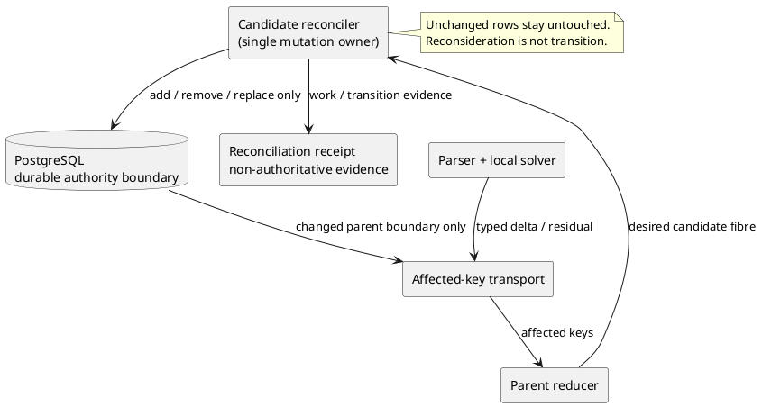

# Direct Delta Compiler Architecture

Status: normative target architecture for the strict numeric SensibLaw compiler.

This document closes the architectural question raised by the performance programme. Future optimization work is convergence toward this architecture, not open-ended discovery of a new execution model after each benchmark.

## Constitution

The central rule is:

> **PostgreSQL is the durable authority boundary, not the internal execution bus.**

The production compiler converges on:

```text
immutable source
  -> bounded parser fibre
  -> packed structural fibre
  -> local semantic solve
  -> typed semantic delta + residuals
  -> affected-key delta transport
  -> document fixed point
  -> durable semantic staging
  -> atomic generation publication
```

Equivalently:

```text
S --Parse--> F --Solve--> Delta_0 --Transport--> ... --Close--> G --Publish--> A
```

where `S` is immutable source, `F` is a bounded execution fibre, `Delta_i` is a typed semantic delta/residual boundary, `G` is a closed candidate generation, and `A` is consumer-visible authority.

The parser, packed carrier and local solver are execution objects. They do not become semantic authority merely because they ran or because their contents can be represented relationally.

## Three object classes

Every runtime object must be classified before a storage mechanism is chosen.

### Execution interior

Examples: spaCy `Doc`, raw token objects, local dependency coordinates, sentence morphology arrays, packed sentence fibres, scratch indexes, temporary candidate relations, local adjacency and transient solver state.

Default placement: process memory or a compact content-addressed execution artifact.

Rule:

```text
execution interior !=> mandatory SQL row
```

### Durable non-authoritative execution evidence

Examples: parser receipt, packed fibre artifact, checkpoint, worker attempt, parity projection and diagnostic telemetry.

These may be durable, but no consumer may infer semantic authority from durability alone.

### Semantic authority

Examples: admitted semantic objects/factors, residual/open demands, promoted exports, canonical lookup projections, provenance, authoritative generation identity and publication state.

These belong in the durable authority domain.

## Four persistence cuts

Every production persistence operation must identify one of these cuts.

1. **Input cut** — immutable source bytes/digest and source identity.
2. **Recovery cut** — compact packed execution artifact plus run/partition/checkpoint receipt. Row-wise parser interiors are not required.
3. **Semantic staging cut** — typed deltas, residuals, provenance and receipts in a non-current generation.
4. **Publication cut** — a small atomic transition that makes a validated, closed generation consumer-visible.

A table or write pattern with no persistence-cut owner is presumptively off the production hot path.

## Parser fibres are execution partitions

Parser fibres exist for bounded memory, parallelism and restartability. The semantic object remains the document.

Target:

```text
Parse(source fibre) -> PackedStructuralFibre
```

The packed fibre exposes the local structure required by the semantic reducer: spans, local symbol dictionary/digests, lemma/POS/tag/dependency, head-relative coordinates, morphology, entity annotations and explicit boundary obligations.

The fibre does not need to become a durable relational token graph before local semantic computation can begin.

## Identity layers

The runtime must keep these identities distinct:

- semantic/stable typed identity;
- database-local surrogate identity;
- fibre-local execution address;
- transient solver-path address.

A PostgreSQL `BIGINT` surrogate is a storage coordinate, not intrinsic semantic identity.

Inside packed fibres, dense local integers are permitted for compression. Stable typed digests accompany identities that must survive publication/rebuild boundaries. Database-local surrogates are resolved in batches only for objects that cross a durable authority boundary.

Consequently, production local solving must not require corpus-wide PostgreSQL symbol interning merely to navigate parser structure.

## `semantic_parser_token` status

`execution.semantic_parser_token` remains useful, but its target status is **reference/audit projection**, not mandatory inter-stage bus.

Three supported execution modes are intended:

- **production** — `spaCy -> packed fibre -> local solve`; no parser-token SQL publication on the local critical path;
- **parity/certification** — direct packed solve and relational reference solve are both evaluated and compared at consumer-visible authority;
- **audit/debug** — relational parser projection may be persisted when explicitly requested.

Architectural production gate:

```text
ParserTokenWrites_production = 0
```

## Local semantic solve

For a closed sentence fibre `F_s`:

```text
DBCrossings(LocalSolve(F_s)) = 0
```

The local solver consumes the packed fibre directly and emits a typed boundary such as:

```text
(semantic delta, residuals/demands, alternatives/uncertainty, explicit exports)
```

No sentence-local deterministic operation should take the form:

```text
packed/local state -> SQL -> SELECT -> local solve
```

when all operands already exist inside the bounded fibre.

## Residual-bearing closure

Performance never licenses destructive pruning. If a local fibre cannot resolve a demand, it emits an explicit typed residual. Parents may resolve, refine or re-emit that residual without reopening the closed child interior unless the retained boundary is formally insufficient for the active consumer.

For a closed fibre `f`, the visible boundary is conceptually:

```text
Boundary(f) = Exports(f) U Summaries(f) U Residuals(f) U Scope(f)
```

not `Interior(f)`.

## Delta transport at every hierarchy level

The same execution law applies sentence->paragraph->adaptive/document and to every later hierarchy:

```text
child boundary delta -> affected parent keys -> parent-local reducer -> changed parent boundary delta
```

Never, in the ordinary path:

```text
child changed -> reconstruct child interior -> rebuild accumulated parent state
```

If parent state `P` receives child delta `d` with affected keys `K_d`, local reduction computes only the affected fibres. If the observable parent boundary is unchanged, no outward delta is emitted.

```text
Boundary(P') = Boundary(P)  =>  emitted parent delta = 0
```

Hierarchy work is therefore structurally proportional to emitted semantic deltas times hierarchy depth, not accumulated lower-state size.

## One reconciliation algebra

Every keyed current-state relation uses the same desired/current partition:

```text
(current C, desired D) -> (added, removed, replaced, unchanged)
```

Universal law:

```text
unchanged => zero physical rewrite and zero manufactured semantic transition
```

Reconsideration is not a transition. Reducer invocation is not semantic change. Event history is appended only for actual semantic/execution state transitions owned by that event model.

This applies by default to candidate relations, parent exports, lookup projections, actor summaries, demand state, adjacency products, resolution state and derived current-state caches.

### Single mutation-owner law

Each keyed current-state relation has exactly one active mutation owner.

For candidate membership, the active strict numeric parent path delegates to
`execution.reconcile_numeric_pnf_parent_candidates`. Migration 209 removes
the private candidate delete/reinsert block from
`reduce_numeric_pnf_parent_frontier_affected` and fails closed if the expected
canonical block is absent.

The executable contract is `src/runtime/relation_delta.py`.
The golden formal owner is
`DASHI/Cognition/PNF/RelationDeltaReconciliationExact.agda`.

Required invariants:

- mutation owner count is exactly one;
- private bypass count is zero;
- hot-path reconciler count is exactly one;
- the reconciliation receipt owner is the hot-path owner;
- unchanged rows cause zero candidate writes;
- execution ownership does not promote semantic authority.

### ZKP frame

The normalized O/R/C/S/L/P/G/F frame is:

- O: strict numeric PNF candidate reconciliation.
- R: route active candidate membership mutation through one desired/current reconciler.
- C: migration 209 plus the relation-delta and affected-boundary formal owners.
- S: affected demand keys, current candidate fibre, desired candidate fibre, reconciliation receipt.
- L: exact relation-delta partition plus sparse affected-key lattice.
- P: one mutation owner; retain unchanged rows; emit only real relation deltas.
- G: preserve semantic authority with zero private bypass and zero manufactured unchanged transitions.
- F: duplicate owners + private bypasses + unchanged rewrites + missing hot-path reconciliation receipts.

### C4 execution view



## PostgreSQL's five production jobs

PostgreSQL remains central, but its role is deliberately narrower:

1. **Durable semantic authority** — canonical semantic state and provenance.
2. **Global shared identity at publication boundaries** — batch resolution of stable identity to database-local numeric identity where required.
3. **Genuinely global reconciliation** — global lookup, cross-document exposure, unresolved-demand matching across committed boundaries, uniqueness and other work whose operands are not already in one bounded fibre.
4. **Recovery/checkpoint metadata** — run, partition, attempt, generation, artifact digest and checkpoint state.
5. **Reference/audit projections** — including relational parser projection when certification/debugging requests it.

PostgreSQL is not the mandatory engine for token-local traversal, sentence-local PNF assembly, morphology decoding, execution-only scratch topology, per-token intermediate publication, same-document local joins already resident in memory, or repeated reconstruction of closed child interiors.

## Generation-based authority publication

Durability and publication are separate.

Local workers may checkpoint packed artifacts and semantic deltas/residuals into a candidate generation using short transactions. Those rows are durable but not consumer-visible authority.

For document `d`, compilation builds a new generation `G(d,n+1)` out of sight. Publication occurs only after the generation is valid, closed and certified for the required contract. Consumer visibility changes through a small atomic generation transition rather than by keeping the entire compilation inside one multi-minute transaction.

Target shape:

```text
many resumable staging commits + one small authority publication transaction
```

This reduces lock lifetime and rollback cost without weakening atomic consumer visibility.

## Direct/reference commuting law

The relational parser path remains the executable reference during convergence. For every required consumer `C`:

```text
Observe_C(Solve_packed(F)) = Observe_C(Solve_SQL(Project_SQL(F)))
```

or the existing consumer-indexed equivalence relation where authority is intentionally relational rather than syntactically identical.

Physical surrogate IDs, transaction coordinates and execution timing are not semantic equality criteria.

## Transport commuting law

For every hierarchy edge admitted to the delta-native path:

```text
Restrict(Apply(x,d)) = Apply(Restrict(x), Transport(d))
```

subject to the explicit consumer and dependency conditions owned by the formal model.

## Fixed point

The compiler is a staged fixed-point machine:

```text
Compiler = Publish o Close o Transport o Solve o Parse
```

The meaningful closure criterion is no remaining outward semantic delta/residual action for the active document generation, not "all tables were rescanned".

## Observability plane

Authority evidence and diagnostic evidence are separate planes.

The diagnostic plane must survive semantic rollback, timeout and SIGTERM, but it never has semantic authority. Partial runs are always marked acceptance-ineligible.

Every optimization probe should preserve, where available:

- parser wall/work and CPU;
- direct projection/packing work;
- local solve work;
- delta transport work;
- database publication work;
- reference-only work;
- process-tree RSS;
- PostgreSQL wait events and locks;
- SQL template calls/rows/time;
- rows inserted/updated/deleted;
- affected/touched keys;
- unchanged rows skipped;
- emitted semantic deltas.

A 30-60 second killed probe and a full run should expose the same diagnostic dimensions. Full semantic/performance acceptance still requires the designated completed workload and accepted ledger.

Flame graphs are conditional diagnostics: use them when CPU is a material fraction of wall time. For wait-heavy traces, owner timing -> DB waits/churn -> SQL-template timing is the preferred diagnostic hierarchy.

## Physical acceptance constitution

Correctness is prior to speed. Required consumer observations must match the reference semantics.

The target execution laws are:

```text
DBCrossings_sentence_local = 0
ParserTokenWrites_production = 0
UnchangedRelationWrites = 0
ClosedChildInteriorReads_parent = 0
HierarchyWork proportional to EmittedDeltas * HierarchyDepth
GlobalIDResolution only at durable publication boundaries
```

The programme performance gates remain staged. The current practical gate is total strict execution <= 1.5x bare spaCy on representative accepted workloads. The long-term post-parser constitution is <= 0.1x spaCy where that target is achievable without weakening semantics. Partial interval diagnostics never certify either gate.

## Current empirical motivation

The 211/212 short-run probes removed the prior hierarchy publication pathology and reduced symbol-lock contention, leaving PostgreSQL parser/token materialization as the dominant short-run owner. The exact diagnostic values remain evidence, not architectural axioms; the architecture does not depend on one historical trace.

The conclusion is architectural: making the relational parser projection cheaper is useful for reference/audit mode, but production convergence removes it from the mandatory local semantic critical path.

## Formal owners in DASHI

The architecture is not a new semantic compiler. It assembles existing formal owners into one execution constitution. The canonical formal paths are on `dashi_agda` master. The current single-owner reconciliation alignment is staged on `agent/sensiblaw-reconciliation-toe` pending merge.

Primary formal entry point:

- [`DASHI/Cognition/PNF/DirectDeltaCompilerArchitectureExact.agda`](https://github.com/chboishabba/dashi_agda/blob/master/DASHI/Cognition/PNF/DirectDeltaCompilerArchitectureExact.agda)

Existing owners that constrain the runtime include:

- [`DreamFlowExecutionEverything.agda`](https://github.com/chboishabba/dashi_agda/blob/master/DASHI/Cognition/PNF/DreamFlowExecutionEverything.agda)
- [`DeltaNativePNFDreamFlowExact.agda`](https://github.com/chboishabba/dashi_agda/blob/master/DASHI/Cognition/PNF/DeltaNativePNFDreamFlowExact.agda)
- [`FibreSolverDeltaStreamExact.agda`](https://github.com/chboishabba/dashi_agda/blob/master/DASHI/Cognition/PNF/FibreSolverDeltaStreamExact.agda)
- [`FibreNaturalDeltaTransportExact.agda`](https://github.com/chboishabba/dashi_agda/blob/master/DASHI/Cognition/PNF/FibreNaturalDeltaTransportExact.agda)
- [`SentenceParagraphNaturalDeltaExact.agda`](https://github.com/chboishabba/dashi_agda/blob/master/DASHI/Cognition/PNF/SentenceParagraphNaturalDeltaExact.agda)
- [`FibreLocalTokenAddressExact.agda`](https://github.com/chboishabba/dashi_agda/blob/master/DASHI/Cognition/PNF/FibreLocalTokenAddressExact.agda)
- [`FibreLocalPackedStorageExact.agda`](https://github.com/chboishabba/dashi_agda/blob/master/DASHI/Cognition/PNF/FibreLocalPackedStorageExact.agda)
- [`PackedNormativeDeltaAuthorityBridgeExact.agda`](https://github.com/chboishabba/dashi_agda/blob/master/DASHI/Cognition/PNF/PackedNormativeDeltaAuthorityBridgeExact.agda)
- [`SparseFibredFrontier.agda`](https://github.com/chboishabba/dashi_agda/blob/master/DASHI/Cognition/PNF/SparseFibredFrontier.agda)
- [`AffectedBoundaryLocalReductionExact.agda`](https://github.com/chboishabba/dashi_agda/blob/master/DASHI/Cognition/PNF/AffectedBoundaryLocalReductionExact.agda)
- [`RelationDeltaReconciliationExact.agda`](https://github.com/chboishabba/dashi_agda/blob/master/DASHI/Cognition/PNF/RelationDeltaReconciliationExact.agda)
- [`DreamFlowRuntimeComplexityExact.agda`](https://github.com/chboishabba/dashi_agda/blob/master/DASHI/Cognition/PNF/DreamFlowRuntimeComplexityExact.agda)

If runtime code contradicts these formal boundaries, the default interpretation is an implementation/architecture gap to close, not a reason to weaken the formal model.

## Decision rule for future optimization work

Do not ask "what should we optimize next?" as an open-ended architecture question.

Ask:

> **Which remaining runtime edge violates the Direct Delta Compiler Architecture, and which measured violation has the highest current cost?**

Benchmarks prioritize convergence. They do not redefine the destination.
